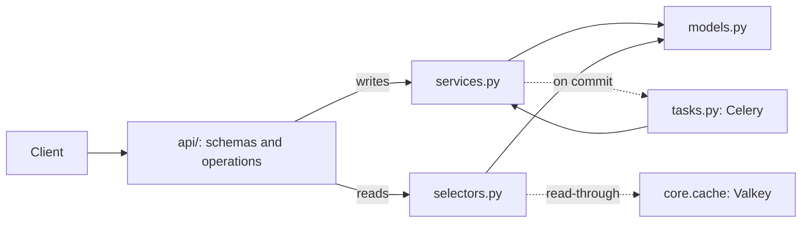
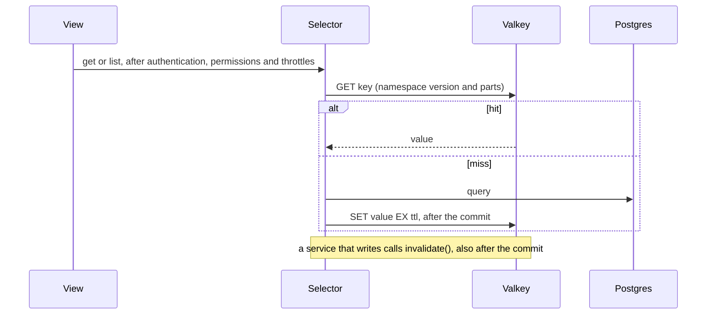
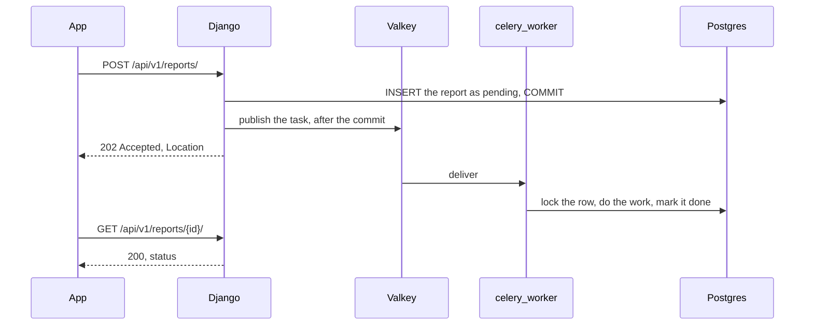
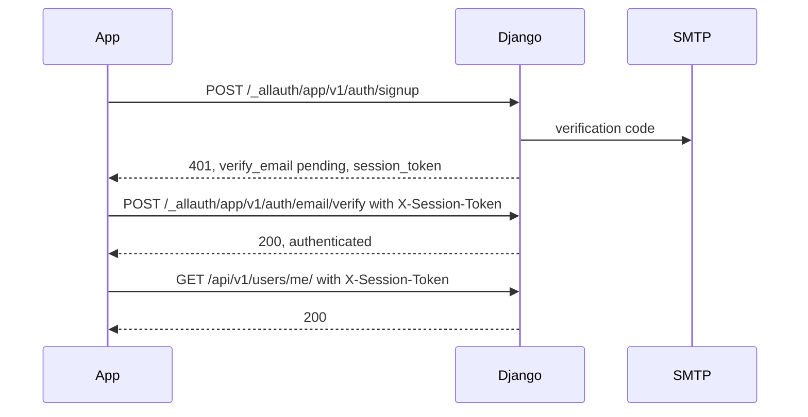
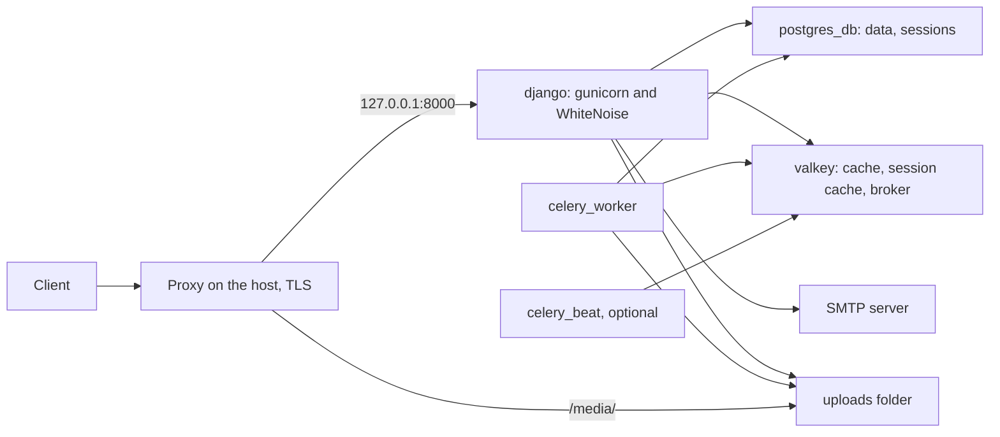

# Architecture

Why the template is shaped this way. A local Graphify graph can show what calls what; it complements this page and does not replace it ([development.md#graphify](development.md#graphify)).

## Layers

Each domain app under `apps/` splits its code by what it does, following the [HackSoft Django Styleguide](https://github.com/HackSoftware/Django-Styleguide):

- `models.py`: fields, constraints and small properties. File fields follow [docs/files.md](files.md) (`core.files.UploadTo`, `MaxFileSizeValidator`). Invariants live in database constraints where possible and are validated again by services through `full_clean()`; records that must persist are deactivated, not deleted. Domain models inherit `core.models.BaseModel` for `public_id`, `created_at` and `updated_at`; `User` builds on `AbstractBaseUser` and `PermissionsMixin` ([decisions/0014](decisions/0014-user-extends-abstractbaseuser-and-permissionsmixin.md)). Both timestamps come from the database clock (`Now()`), so every worker shares one clock and a new row has `created_at == updated_at`. `save()` sets `updated_at` (also on `save(update_fields=[...])`), and `BaseQuerySet.update()` bumps it on bulk updates; `bulk_update()` does not, so pass `updated_at` explicitly. FKs default to `on_delete=models.PROTECT`. `CASCADE` only for children owned by their parent and listed in `CASCADE_ALLOWED` (`core/tests/test_on_delete_policy.py`). `SET_NULL` only for optional references where losing the link is acceptable. Deleting a protected row returns 409 `protected`. Append-only tables and an admin audit log are opt-in recipes in [data.md](data.md).
- `services.py`: every write. Keyword-only arguments, `transaction.atomic`, `full_clean()` before `save()`. Side effects (email, Celery tasks, cache invalidation, webhooks, files) run in `transaction.on_commit(...)`, never directly inside `atomic` (`core.tasks.enqueue_on_commit` and `core.cache.invalidate` already do); read-modify-write on the same row takes `select_for_update()` inside the transaction. A business-rule rejection raises `core.exceptions.ApplicationError` (or `ConflictError`) with a code from [docs/api.md](api.md). Example: `apps.users.services.user_update`.
- `selectors.py`: every read that is more than a plain lookup. A hot or expensive read is cached here, never in a view ([Caching](#caching)). Example: `apps.users.selectors.user_get`.
- `tasks.py`, only in an app that needs one: Celery tasks. A task is thin: it loads rows by id, calls a service and handles retries ([Background tasks](#background-tasks)).
- `api/`: Django Ninja routers, operations and Pydantic schemas. Views validate input, call one service or selector and return a schema. `core.api` returns every error as `{"code", "detail"}` ([docs/api.md](api.md)): it converts Django `ValidationError` to `400`, `ObjectDoesNotExist` to `404`, `ProtectedError`/`RestrictedError` and `ApplicationError` to their status, returns `401` on unauthenticated calls, and paginates list endpoints (`page_size = 20`). Routers are mounted in `config/api.py` and served under `/api/v1/`. APIs never expose integer pks; use `public_id` (UUIDv7, `core.models.PublicIdModel`). Every list or detail operation scopes its lookup to the requesting user or tenant, and has a test that another user's object returns 404.

Tests mirror that split under `tests/`: `services/` and `selectors/` for the framework-neutral layers, `http/` for the HTTP contract and `ninja/` for tests of Django Ninja itself ([development.md#test-layout](development.md#test-layout)).

### Services and selectors

The rules that keep business logic out of the API layer, so another API framework only replaces `api/` ([HackSoft Django Styleguide](https://github.com/HackSoftware/Django-Styleguide)):

- **Names.** `<entity>_<verb>`, entity first: services `user_update`, `user_deactivate`, `user_anonymize`; selectors `user_get`, `user_list`, `user_visible`. One module per layer (`services.py`, `selectors.py`); a large app may turn either into a package of the same name.
- **Signatures.** Keyword-only arguments (`def user_update(*, user: User, name: str) -> User`), fully typed ([Strict typing](#strict-typing)). Arguments are plain values and model instances: never a `request`, a Ninja schema, or a response. The operation reads `request.user` and the validated schema fields and passes them by name.
- **Writes.** `@transaction.atomic`, `full_clean()` before `save(update_fields=[...])`, side effects on commit (`core.cache.invalidate`, `core.tasks.enqueue_on_commit`), `select_for_update()` for read-modify-write. A service returns the instance it wrote.
- **Errors.** `full_clean()` raises Django's `ValidationError`; a broken business rule raises `core.exceptions.ApplicationError` or `ConflictError` with a code from [api.md#error-codes](api.md#error-codes). Never an HTTP status by hand or a Ninja HTTP exception for a domain rule: the API layer maps them ([api.md#domain-errors](api.md#domain-errors)).
- **Reads.** A selector returns a `QuerySet` (lists, so the view can paginate) or one instance, and owns `select_related()`, `prefetch_related()`, ordering and caching.
- **Callers.** Views, the admin, management commands and Celery tasks write through services. A rule that more than one caller needs lives in the service, not in a view, an admin method or a command.
- **Accounts.** django-allauth headless owns signup, login, email verification, password reset and change, sessions and MFA. Do not write services for them; customize through `apps/users/adapters.py`.
- **Tests.** `apps/<app>/tests/services/test_<function>.py` and `tests/selectors/`, framework-neutral: they call the function, never an HTTP client ([development.md#test-layout](development.md#test-layout)).

`core/tests/test_layer_conventions.py` fails on a public service or selector that takes a positional argument or a transport object, or that imports `django.http`, Django Ninja or another API framework.

### Strict typing

pyright and mypy check every module ([typing.md](typing.md)); mypy requires annotations everywhere (`disallow_untyped_defs`). The domain layer also gets the rest of `--strict` plus `disallow_any_explicit` (`[[tool.mypy.overrides]]` in `pyproject.toml`): services, selectors, models and managers of every app, and `core.models`, `core.exceptions`, `core.errors`, `core.cache` and `core.tasks`. That means no `Any`, no bare `list` or `dict`, no call into untyped code, no `Any` returned. They are what another API framework would call, so their signatures are the contract; a wrong argument fails `mypy` before any test runs. An argument passed through untouched is `object`, not `Any` (`**extra_fields: object`), and an override of `Model.save` repeats Django's keyword-only signature. When a library returns `Any` (a cache `get()`, `Session.get_decoded()`), narrow it with `cast()` or a typed variable at that line, never with a suppression comment ([typing.md#suppressions](typing.md#suppressions)).

### Import contracts

`lint-imports` (import-linter, in `scripts/check.sh lint`) enforces the layers above with the contracts in `[tool.importlinter]` of `pyproject.toml`:

- Only the API layer imports Django Ninja: `apps/<app>/api/` and `core/api/`, plus the tests under `tests/ninja/`. Routers are mounted in `config/api.py`. Everything else, including `core.net` and the error handlers, works without Ninja, so another API framework replaces the API layer and nothing else.
- Domain code (`models`, `managers`, `services`, `selectors`, `signals`, `tasks`, and `core.models`, `core.exceptions`, `core.errors`, `core.cache`, `core.tasks`) never imports the API layer or `config`.
- `core` never imports an app, so shared code stays reusable when apps change. A command that writes app data lives in that app (`seed_dev` is in `apps/users/management/commands/` and uses `user_update` and `user_primary_email_sync`). Only `core/tests/` and the `config` it loads are exempt.
- Inside an app, imports go down `api` → `admin` | `management` | `views` | `adapters` → `services` : `tasks` → `signals` → `selectors` → `models` → `managers`. Modules on one line with `|` never import each other; `services` and `tasks` may (docs/tasks.md). Every layer is optional, and modules outside the list (`apps.py`, `forms.py`, `tests/`) are not checked.

A broken contract names the import and its line. Fix the import; do not add an `ignore_imports` entry without a comment that says why, as the one for `managers` does.

Model details that the code relies on:

- `public_id` is a UUIDv7: time-ordered, and a client can generate one. `User` builds on `AbstractBaseUser` and `PermissionsMixin` and declares `public_id` itself; it does not inherit `core.models.PublicIdModel`.
- `Now()` is PostgreSQL's statement timestamp. `save()` reads `updated_at` back through `RETURNING`; `save(update_fields=[])` leaves it untouched. Pass `updated_at` to `QuerySet.update()` when it needs a value other than now.
- `User` has a single `name` field, because first and last names do not cover names worldwide. `UserManager.normalize_email` NFKC-normalizes, strips and lowercases the whole address, not only the domain. `UserManager` extends `BaseUserManager`; its creators `create_user`, `create_superuser`, `acreate_user` and `acreate_superuser` take the email first, then the password.

## Performance

- Selectors own the query shape. A list selector (`<resource>_list(*, user, filters=None) -> QuerySet`) returns a queryset with `select_related()` for every FK or one-to-one the output schema reads, and `prefetch_related()` (or `Prefetch(..., queryset=...)`) for every reverse FK or M2M. Operations call it and return its queryset; they never declare relations themselves. Example: `apps.users.selectors.user_list`.
- Output schemas never trigger queries: no dotted `Field(alias="fk.field")`, `resolve_*` method or nested schema over a relation the selector did not preload ([Ninja: aliases](https://django-ninja.dev/guide/schemas/#aliases), [resolvers](https://django-ninja.dev/guide/schemas/#resolvers)). Counts and sums come from `annotate()` in the selector (`items_count=Count("items")`), never `obj.items.count()` per row.
- Use `exists()` for existence checks, `bulk_create`/`bulk_update`/`queryset.update()` for batches, and `iterator(chunk_size=2000)` for exports. Use `only()`/`defer()` only to skip wide columns (large text or JSON), and never on fields the output schema reads.
- `request.user` is already loaded by authentication: do not query it again.
- `full_clean()` in services also runs the unique and constraint checks (one indexed query each). Keep it as the backstop before the database constraints. A duplicate a client can send is checked first, in the service, and answered with 409 `already_exists` ([api.md#duplicates](api.md#duplicates)): `full_clean()` would answer 400 to a request the schema allows.
- Admin for tables that can grow: `list_select_related` for FKs in `list_display`, `show_full_result_count = False`, `raw_id_fields` or `autocomplete_fields` for FKs to large tables (the default `<select>` loads every row), and `search_fields` with `=`/`^` prefixes or a trigram index instead of a plain `icontains` on large tables.
- Every endpoint has a query budget, and every list a constant-query test (AGENTS.md, "Testing"); django-zeal fails N+1 queries in tests.

### Indexes

- Default list ordering is the primary key (`"id"`/`"-id"`, or `"-public_id"`). Any other default ordering, every ordering a client may choose, and every filter used on a list must be backed by an index. `core/tests/ninja/test_list_indexes.py` enforces it for ordering.
- Composite indexes follow the query: equality filters first, then the ordering columns in the same direction, then `id` as tie-breaker, e.g. `models.Index(fields=["owner", "-created_at", "-id"], name="inventory_item_owner_crt_idx")`. Name indexes `<app>_<model>_<cols>_idx`, abbreviating columns to stay within Django's 30-character limit.
- `BaseModel` does not index `created_at`; add an index per model only when a list orders or filters by it.
- On large tables, add indexes with `AddIndexConcurrently` in a migration with `atomic = False`, so the table is not locked while the index builds.
- Case-insensitive search on large tables needs a functional (`Lower(...)`) or trigram index; a plain `icontains` is a sequential scan.

## Caching

Valkey is the cache in every environment except tests, which use LocMem. The backend is `core.cache_backend.ValkeyCache`: Django's `RedisCache` on redis-py, plus a TTL on every key and a policy for outages. One server holds everything that several processes must share:

| Database | Use |
| --- | --- |
| 0 | The cache: API throttles, allauth rate limits, django-axes counters, the cached copy of each session, and cached reads |
| 1 | The Celery broker: the task queue |
| 2 | Reserved for a Celery result backend, which the template does not use ([NEXT-STEPS.md](NEXT-STEPS.md#per-project-options)) |
| 14, 15 | The integration tests (`core/tests/test_valkey_integration.py` and `core/tests/ninja/test_valkey_integration.py`) |

- **Cached reads** belong to selectors, through `core.cache.read_through`. Keys are `<KEY_PREFIX>:<VERSION>:<app>.<resource>:v<namespace version>:<parts>`. A service that writes calls `core.cache.invalidate()`, which replaces the namespace version once the transaction commits; the old entries are never read again and expire.
- **Every key has a TTL.** Valkey runs with `volatile-lru`: when memory runs out it evicts the least recently used keys that have a TTL, and never the task queue, which has none. `ValkeyCache` turns `timeout=None` into `VALKEY_MAX_TTL` (30 days), so no library can write a key that lives forever.
- **Sessions** use `cached_db`: a request reads its session from Valkey, and the row in `django_session` is the durable copy, so restarting Valkey signs nobody out. Deactivating a user deletes that user's sessions from both.
- **Staleness.** A cached read is at most one TTL old after a write that skipped invalidation: a Valkey outage, raw SQL, or a `queryset.update()` without `invalidate()`. Data that must be exact is not cached.
- **Outages.** Reads and writes fail open and are logged: a selector falls back to the database, and throttles and rate limits stop counting. Deletes raise, so a session that could not be removed never looks removed ([security.md](security.md#valkey-outages)). Meanwhile `/health/` answers 503 `cache unavailable`; `/health/live/` does not look at Valkey.
- **HTTP caching is separate.** API responses are `no-store` (`core.middleware.ApiNoStoreMiddleware`), and `cache_page` and the cache middleware are banned ([api.md](api.md#caching)).

The rules for code are in AGENTS.md, "Caching (Valkey)".

Key and cache details:

- The namespace version lives under `ns:<namespace>` and expires after seven days (`NAMESPACE_TTL`). Versions are `time.time_ns()`, never a counter that restarts at 1.
- Unsafe or long key parts are hashed, so client input cannot forge a `:` separator; when the joined parts pass 160 characters, they are hashed as one. Never derive `DJANGO_CACHE_VERSION` from `APP_RELEASE`: every deploy would reset the rate limits.
- `read_through` has no default `ttl`, and it stores the value after the commit, so a test that never commits always misses. Any cache error, including a bad pickle, falls back to the loader.
- `invalidate()` writes with `strict_set` (never fail-open). If Valkey is down after the commit, the error is logged (`robust=True`) and stale entries live until their TTL.
- `VALKEY_MAX_TTL` becomes `MAX_TTL`, a top-level `CACHES` key, not an `OPTIONS` one.
- Do not call `user_get` for `request.user`, and do not invalidate the users namespace when only `last_login` changed.
- django-axes keeps its counters in the default cache, so every worker shares them.
- On Valkey, `cache.clear()` is `FLUSHDB`: it wipes sessions, rate limits and throttles whatever the key prefix. Only `conftest.py` may call it, on the in-memory test caches; `scripts/check.sh lint` fails on any other call. The check (`scripts/forbid_cache_clear.py`) parses the code, so a comment or a docstring that names the call passes.

- TTLs: 60 seconds for lists and counts, 300 seconds for single objects, up to 24 hours for reference data. A namespace that caches model instances (`user_get` in `apps/users/selectors.py`) bumps its cache version (`USER_CACHE_VERSION`) when the model's fields change (a cached instance is a pickle of its field values) and defers secret fields such as the password.

## Background tasks

Celery runs the work that does not fit in a request: reports, exports, bulk email, outgoing webhooks, calls to slow APIs. It is wired and a worker runs by default, but the template ships no business task; `core.ping` is a no-op for tests and smoke checks. [tasks.md](tasks.md) has the recipes and the worker's settings.

- `config/celery.py` builds the app from the `CELERY_*` settings and discovers the `tasks.py` of each app. The broker is database 1 of Valkey. There is no result backend: the outcome of a task lives in the row it updates, and the client polls that resource.
- Services enqueue with `core.tasks.enqueue_on_commit`: nothing is published on a rollback, and if the broker is down after the commit the error is logged and the request still succeeds. Work that must never be lost uses an outbox row instead ([tasks.md](tasks.md#recipe-work-that-must-not-be-lost)).
- A message is acknowledged when its task ends (`acks_late`), so a task may run more than once, and every task is idempotent. A message that is not acknowledged within an hour (the visibility timeout) is delivered again, so the hard time limit of a task stays below it: 30 minutes by default.
- The worker logs like the web process, one JSON object per line, with `task_id`, `task_name` and the `request_id` of the request that enqueued the task.
- Periodic tasks need `celery_beat`, an optional compose profile. Tests run tasks inline and never reach a broker.
- Email is not a task: allauth sends its codes inside the request, so a code never sits in the broker ([email.md](email.md)).

The rules for code are in AGENTS.md, "Background tasks (Celery)".

## Authentication

Accounts are handled by django-allauth in headless mode (`HEADLESS_ONLY = True`): there are no HTML login or signup pages. The client is an app, so the session travels in the `X-Session-Token` header instead of a cookie.

- Email is sent synchronously inside the request (on purpose: the code never sits in the broker; see [email.md](email.md)). If SMTP fails, `apps.users.adapters.AccountAdapter.send_mail` logs the error and the request still returns the normal pending flow, because the user or reset request already exists; the client can ask for a new code at `/_allauth/app/v1/auth/email/verify/resend`.
- Login is by email; there is no username. Verification and password reset use codes, while `FRONTEND_URL` populates `HEADLESS_FRONTEND_URLS` for existing-account and unknown-account notification emails.
- The API authenticates `X-Session-Token` first (`core.api.auth.XSessionTokenAuth`, returning `401` when unauthenticated) and falls back to the Django session (`core.api.auth.cookieAuth`), which a staff member's browser sends from the admin and from Swagger at `/api/v1/docs/`. Sessions are `cached_db`: the session behind a token is read from Valkey, not from PostgreSQL, on every authenticated request.
- `CORS_URLS_REGEX` (`^/(api|_allauth)/.*$`) covers `/api/v1/` and `/_allauth/`. Allowed origins come from `CORS_ALLOWED_ORIGINS`. `CORS_EXPOSE_HEADERS` lets a browser client read `Location` (201), `Retry-After` (429), `ETag`, and `Deprecation`, `Sunset` and `Link`; a browser hides any other response header from JavaScript cross-origin. `CORS_ALLOW_HEADERS` adds `If-Match` to the session and allauth headers.
- allauth rate limits signup, login and code attempts through the cache: Valkey, which every gunicorn worker shares.

`allauth.mfa` is installed but inert (`MFA_SUPPORTED_TYPES = []`), so a project can turn on two-factor authentication later without a new app ([auth/](auth/README.md)). The template does not install `django.contrib.sites`: allauth falls back to the request host, and the domain lives in `ALLOWED_HOSTS` and `FRONTEND_URL`. Registration is open (`DJANGO_ACCOUNT_ALLOW_REGISTRATION`, default true).

## Settings

| Module | Used by | Email | Cache | Tasks |
| --- | --- | --- | --- | --- |
| `config.settings.local` | `manage.py`, dev container | Mailpit over SMTP | Valkey of the dev stack (`VALKEY_URL`, DB 0) | The dev `celery_worker` |
| `config.settings.test` | pytest, mypy | locmem outbox | In memory (LocMem) | Inline, on an in-memory transport |
| `config.settings.production` | the production image | SMTP from `DJANGO_MAILER_*` variables | Valkey (`VALKEY_URL`, DB 0) | The `celery_worker` service |

Each module reads the environment through its typed class in `config/settings/env.py` ([settings.md#environment-variables](settings.md#environment-variables)). Email uses the `MAILERS` setting from Django 6.1. In production, error emails go through the `admin-logging` mailer, which drops the message when SMTP fails, so an SMTP outage never turns a 500 into a dropped connection. The cache is Valkey; see [Caching](#caching). The `celery` command has no `manage.py` to choose the settings for it: `config/celery.py` defaults to production, and the dev worker sets `config.settings.local` in its compose service.

## Deployment

- The image is built from `docker/prod/Dockerfile`. It runs as UID 1000 and collects static files at build time; WhiteNoise serves them with hashed names. The `APP_RELEASE` build arg (the commit) becomes an environment variable and the OCI `revision` label, and Sentry and the JSON logs report it.
- `docker/prod/start.sh` runs `check --deploy`, then `docker/prod/migrate.sh` (`migrate`), then hands the process to gunicorn. `migrate` runs without the request statement timeout but with a lock timeout (`DJANGO_MIGRATE_LOCK_TIMEOUT_MS`, 10 s), so it fails instead of waiting forever behind a lock. With more than one django replica, `DJANGO_MIGRATE_ON_START=false` skips that step and `migrate.sh` runs once per deploy, so replicas never race to migrate.
- `docker/prod/start-worker.sh` starts the Celery worker from the same image. Compose starts it once `django` is healthy, so no task runs before the migrations. It runs `check --deploy` first, like the web process. `celery_beat` is an optional compose profile (`--profile beat`): run exactly one.
- Database connections are bounded. Persistent connections (`CONN_MAX_AGE`, 60 s) go stale when Postgres restarts, so `CONN_HEALTH_CHECKS` tests one before reusing it. `POSTGRES_CONNECT_TIMEOUT` (5 s) stops a new connection from hanging on an unreachable server, and `POSTGRES_STATEMENT_TIMEOUT_MS` (30 s) cancels a runaway query before it holds every gunicorn thread. The timeouts reach Postgres as the libpq `options` parameter, which takes precedence over `PGOPTIONS`. The worker gets 300 s instead of 30 (`CELERY_POSTGRES_STATEMENT_TIMEOUT_MS`), because a report may need one long query.
- The django, celery_worker and celery_beat containers run with `no-new-privileges`, no Linux capabilities (`cap_drop: ALL`), a read-only root filesystem, a pids limit, and a memory limit (`DOCKER_PROD_DJANGO_MEM_LIMIT` for django, above the login-burst peak in [NEXT-STEPS.md](NEXT-STEPS.md#capacity); `DOCKER_PROD_CELERY_WORKER_MEM_LIMIT` for the worker). PostgreSQL also runs with `no-new-privileges` and a 256 MB `/dev/shm`. Valkey runs the same way (`no-new-privileges`, no capabilities, a read-only root filesystem, a pids limit) as the image's unprivileged user, with a memory limit (`DOCKER_PROD_VALKEY_MEM_LIMIT`); it writes only to its data volume and to the tmpfs that holds its config. Base images are pinned by tag and digest (Dependabot updates both). The runtime stage applies Debian security updates at build time and ships without pip, and CI scans the image with Trivy: a fixed HIGH or CRITICAL vulnerability fails the build.
- Valkey keeps an append-only file in the `valkey_data` volume (`appendonly yes`, `appendfsync everysec`): the cached sessions and the task queue survive a restart, and a crash loses about one second of writes at most. Nothing in it is the source of truth: sessions are also rows in PostgreSQL, cached reads are rebuilt and counters start again. Only queued tasks exist nowhere else. `VALKEY_MAXMEMORY` (256 MB) caps its memory, and `volatile-lru` evicts cache entries, never the queue. Compose writes its password to a config file on a tmpfs, so it never shows in `ps`.
- PostgreSQL, Valkey and the Celery services have no published port (`core/tests/test_compose.py` asserts it). Django is published on `127.0.0.1` only, because Docker ports skip the host firewall.
- The host proxy terminates TLS, sends `X-Forwarded-Proto: https` and `X-Forwarded-For`, and serves `/media/`.
- Uploads live in a host folder outside the repo (`DOCKER_PROD_DJANGO_UPLOADS_PATH`, for example `/srv/project-name/uploads`), bind-mounted at `/app/uploads`; public files go in `uploads/public` (`DJANGO_MEDIA_ROOT`) and private ones in `uploads/private` (`DJANGO_PRIVATE_MEDIA_ROOT`), which nginx only serves through `X-Accel-Redirect` after a view has checked permissions. A bind mount and not a named volume, so deploys never wipe uploads and the host nginx can read them. `start.sh` exits if it cannot write there. Files above 2.5 MB spool to a temporary file while uploading. The container's root filesystem is read-only, so they go to the `/tmp` tmpfs (256 MB of RAM, counted in `mem_limit`): keep it at least `client_max_body_size × workers × threads`, or set `FILE_UPLOAD_TEMP_DIR` to a folder inside the uploads mount.
- Every request gets an id (`core.middleware.RequestIdMiddleware`): a valid incoming `X-Request-ID` (nginx sends `$request_id`) or a new one. It comes back in the `X-Request-ID` response header, appears as `request_id` in every log line, and tags Sentry events when Sentry is on. A task carries the id of the request that enqueued it, so the worker's lines for that task show the same `request_id`, plus `task_id` and `task_name`. Code that needs the id reads `core.middleware.request_id_var.get()` (`"-"` outside a request); the request object has no `request_id` attribute. Sentry itself is optional (`SENTRY_DSN`; `core/sentry.py`), with PII off and credential headers scrubbed. Logs are JSON lines in production and text elsewhere (`DJANGO_LOG_FORMAT`). The gunicorn access log shows the client from `X-Forwarded-For` (the gateway IP is useless behind Docker) and the response's `rid`.
- Two probes are answered by middleware before host and HTTPS checks. `GET /health/live/` (liveness) answers `ok` without touching the database or Valkey: the process is up. `GET /health/` (readiness) runs `SELECT 1` and a Valkey round trip (`ValkeyCache.ping()`: Django's `cache.touch()` on the reserved key `health:ping`, one `EXPIRE` that nothing else writes) on a gunicorn worker and returns 503 when either fails (`database unavailable` or `cache unavailable`). The key in Valkey is `<KEY_PREFIX>:<VERSION>:health:ping` (Django's default key function, so `project:1:health:ping` with the default settings), and the `EXPIRE` gets the `TIMEOUT` of `CACHES`. `EXPIRE` is a write command: an ACL user that may only read, or a read-only replica, answers `NOPERM` or `READONLY` and the probe returns 503, so `VALKEY_USERNAME` needs write access, as the cache itself does; with the connect timeouts, a probe that needs a new connection fails within `POSTGRES_CONNECT_TIMEOUT` or `VALKEY_CONNECT_TIMEOUT` instead of hanging. The production healthcheck calls `http://127.0.0.1:8000/health/` every 10 seconds and marks the container unhealthy after three failures. The worker has its own healthcheck: every 60 seconds it is asked for a reply through the broker (`celery inspect ping`).
- An unhealthy Django container keeps running and keeps port 8000 open. `restart: unless-stopped`, the policy of every service, only restarts a process that exits, so Django does not restart when a check fails, because `docker/prod/start.sh` would run `migrate` and crash-loop until the database accepts connections again. When `SELECT 1` and the Valkey round trip succeed, the same process becomes healthy.
- The host proxy should use that same URL and stop sending traffic unless the status is 200. Docker's health status is not visible to a proxy running on the host. An orchestrator that restarts failing containers points its liveness probe at `/health/live/` and its readiness probe at `/health/`: a database or Valkey outage then removes the container from rotation instead of restarting it in a loop. Both stay private: nginx only lets `127.0.0.1` reach `/health/`.

Details the code relies on:

- `HealthCheckMiddleware` runs before `SecurityMiddleware` and `CommonMiddleware`, and never calls `get_host()`, so the loopback probe is neither redirected to HTTPS nor refused for its host.
- When a Celery task runs without a request id, its task id is used as `request_id` in log lines.
